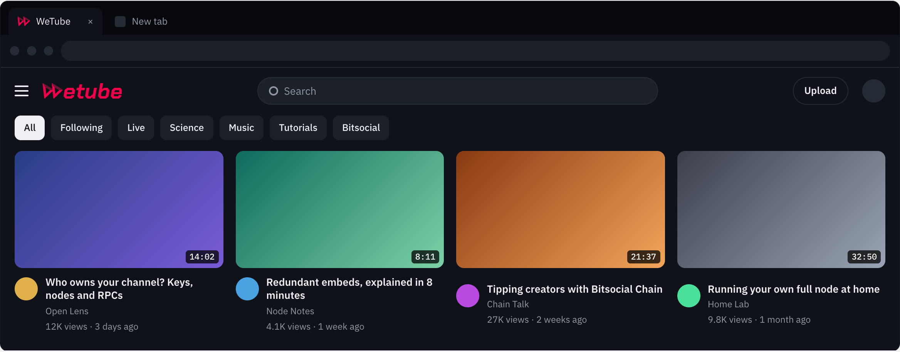
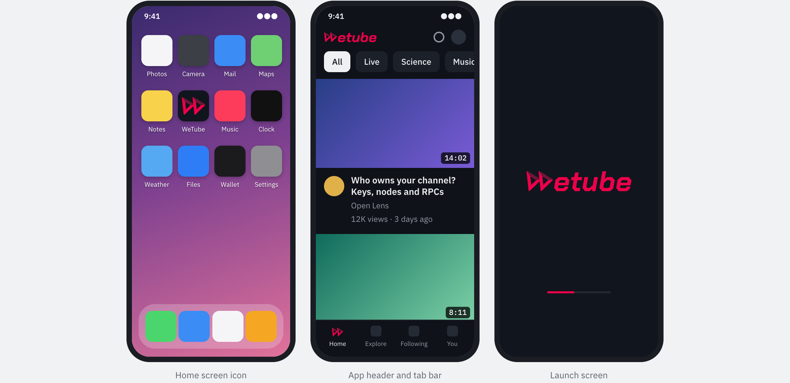

# WeTube

**WeTube is a future YouTube alternative built on Bitsocial.** Every channel is a Bitsocial community owned and hosted by its creator, videos are censorship-resistant through redundant embed sources, curation happens through decentralized voting, and monetization runs on Bitsocial Chain — with no giant corporation that can ban channels, no global admins, and no global rules.

WeTube is part of [Phase 5 of the Bitsocial master plan](https://bitsocial.net/#master-plan-phase-5): decentralize all social media. Phase 5 explicitly names "creator video and a credible YouTube alternative" as one of the formats Bitsocial apps will rival. WeTube is that app.

> **Status: early preview.** A read-only web client is in `src/`: it browses channels and plays videos peer-to-peer, falling back between each video's sources, with no uploads, view counts or monetization yet. Progress is tracked in [roadmap.md](roadmap.md). The full product targets Phase 5 and depends on infrastructure from earlier master plan phases (public RPCs, Bitsocial Chain, pubsub voting).

## Development

The client is a static React app using the same stack as 5chan: Vite, TypeScript, `@bitsocial/bitsocial-react-hooks` and pkc-js running in the browser. Agents working on it follow [AGENTS.md](AGENTS.md), the same workflow as the other Bitsocial clients.

```sh
corepack yarn install
corepack yarn start   # https://wetube.localhost through Portless; PORTLESS=0 serves http://localhost:5180
corepack yarn test
corepack yarn build   # static output in build/
```

Home page channels are listed in [src/data/channels.ts](src/data/channels.ts): the Open Movies demo channel (the Blender open movies, each mirrored on several hosts) and Seedit's `videos-posting.bso`. Any community opens by typing its address in the search box.

Until the [video post BSIP](video-sources.md#the-post-format-now-and-in-the-bsip) exists, a video is an ordinary post: `title` is the video title, `link` is the primary source, and `content` is the description, optionally followed by mirror sources. The client plays YouTube, Invidious, Vimeo, PeerTube, Odysee, Bitchute and Streamable embeds, direct video files and `ipfs://` links:

```text
What this video is about.

Mirrors:
https://vimeo.com/76979871
ipfs://bafy…/video.mp4
```

Authors can edit `content` but not `link`, so the mirror list is the part that can change after posting.

## Look and Feel





Concept mockups with placeholder videos and channels, showing the [WeTube logo](design/logo/) in use. App icons, the player watermark, a share card, sizes and colors are in the [logo showcase](design/logo/README.md#showcase).

## The Thesis

YouTube is a single company that hosts every video, ranks every video, monetizes every video, and can delete any channel at will. Creators build audiences of millions on infrastructure they do not control and can lose overnight.

WeTube splits YouTube into its parts and decentralizes each one:

| YouTube function | WeTube equivalent |
|---|---|
| Channel | A Bitsocial community, owned by a cryptographic key the creator holds |
| Channel hosting | The creator's own full node, or a non-custodial public RPC (e.g. Forge RPC) |
| Video hosting | A list of redundant embed sources per video (web embeds, IPFS, WebTorrent) |
| Comments, likes, dislikes | Bitsocial replies and votes, seeded by users peer-to-peer |
| View counts | Open problem — likely aggregated from each embed source's counter by competing RPC/indexer aggregators |
| Homepage / trending | Categories: community lists of channels, ranked by users' pubsub votes |
| Recommendation algorithm | Provided by competing public RPCs; users can switch it or turn it off |
| Monetization | Bitsocial Chain: tipping, revenue sharing; ads run by RPCs or by channel owners themselves |
| Terms of service, global bans | None. Each channel sets its own rules; no one can set rules for all channels |

The key insight: **Bitsocial does not need to host video files to make video censorship-resistant.** It only needs to host the *list of sources* for each video — and that list is text, which is exactly what the Bitsocial protocol already makes censorship-resistant. See [video-sources.md](video-sources.md).

## What Makes a Channel Unbannable

A WeTube channel is a Bitsocial community: addressed by a public key, hosted by the owner's node, and moderated only by the owner. There is no registrar, platform, or admin above the channel owner. The owner can:

- run their own full node for maximum censorship resistance, or use a public RPC like Forge RPC (non-custodial — they can exit to self-hosting at any time),
- post videos that no one else can take down,
- moderate comments under their own videos, under their own rules,
- monetize however they want — their channel is effectively their own site.

Viewers connect to channels purely peer-to-peer, exactly like 5chan users connect to boards. And because channels are ordinary Bitsocial communities, they are browsable from other Bitsocial clients too (Seedit, 5chan, the flagship app) — WeTube just renders them as a video experience.

## Documents

- [how-it-works.md](how-it-works.md) — architecture: channels as communities, nodes, RPCs, the posting model
- [video-sources.md](video-sources.md) — the embed source list: how videos stay up without Bitsocial hosting them
- [curation-and-discovery.md](curation-and-discovery.md) — categories as voted community lists, discovery without a global algorithm
- [views.md](views.md) — view counts through view providers that viewers choose
- [roadmap.md](roadmap.md) — what is built, what is next, and the decisions behind it
- [monetization.md](monetization.md) — tipping, revenue sharing, and ads via Bitsocial Chain and RPCs
- [open-questions.md](open-questions.md) — design decisions not yet made
- [design/logo](design/logo/README.md) — the WeTube logo: files, colors, construction, and mockups

## License

[GPL-3.0-or-later](LICENSE)

## Ecosystem Context

- Bitsocial protocol docs: https://bitsocial.net
- Pubsub voting (curation layer): `bitsocialnet/pubsub-voting`
- Bitsocial Chain (economic layer): `bitsocialnet/bitsocial-chain` and https://bitsocial.net/chain
- Sibling clients: 5chan (imageboard), Seedit (forum)
