# WeTube logo

Two right-pointing triangles, a fast-forward symbol and the counterpart to a single play button, followed by lowercase **etube**. Each triangle's left and lower edge is red; together they read as the W (`\ / \ /`). The top edges are pale, so the W reads first while the two play triangles stay whole.

| Part | On light | On dark |
| --- | --- | --- |
| W strokes and etube | `#ed004a` (4.5:1 on white) | `#ed004a` (4.1:1 on `#11151d`) |
| Top edges | `#f6a8c0` | `#6c1636` |

Avoid backgrounds where the red drops below 3:1, such as mid grays or the brand red itself.

## Files

| File | Use |
| --- | --- |
| [wetube-logo-on-light.svg](wetube-logo-on-light.svg) · [PNG](wetube-logo-on-light.png) | Full logo, light backgrounds |
| [wetube-logo-on-dark.svg](wetube-logo-on-dark.svg) · [PNG](wetube-logo-on-dark.png) | Full logo, dark backgrounds |
| [wetube-mark-on-light.svg](wetube-mark-on-light.svg) · [PNG](wetube-mark-on-light.png) | Symbol only, light backgrounds |
| [wetube-mark-on-dark.svg](wetube-mark-on-dark.svg) · [PNG](wetube-mark-on-dark.png) | Symbol only, dark backgrounds |
| [wetube-favicon.svg](wetube-favicon.svg) · [PNG](wetube-favicon.png) | Browser tab icon: the symbol in a square cropped to it, without the margins. The SVG's top edges follow the browser's light or dark theme; the 64 px PNG keeps the dark ones |

SVGs are self-contained vectors with no font dependency. PNGs are transparent: logos 2400 px wide, symbols 1024 px tall. Every file has an even 24-unit side and 28-unit top and bottom margin around the artwork, so the symbol centers on its own bounds (for example in an app icon).

## Construction

- Both triangles share one outline, repeated 62.86 units to the right, with a 16.8-unit border and 5-unit clipped corners.
- Red and pale meet on each corner's bisector, where the border's outer and inner corners line up, so every stroke keeps its full width.
- The symbol is scaled so its clipped corners span exactly the height of etube: its top meets the top of the `b` and its bottom corners sit on the baseline.
- etube is [Chakra Petch](https://github.com/google/fonts/tree/main/ofl/chakrapetch) Bold Italic, converted to outlines. The font and its SIL Open Font License 1.1 are in [fonts/](fonts/).

[build.py](build.py) regenerates every file: `uv run build.py` (PNGs need `rsvg-convert`).

## Showcase

[showcase.html](showcase.html) is an interactive brand sheet: open it in a browser to try the logo on different backgrounds and sizes, and to switch the website mockup between light and dark. The screenshots below were captured from it. Mockups use placeholder videos and channels.

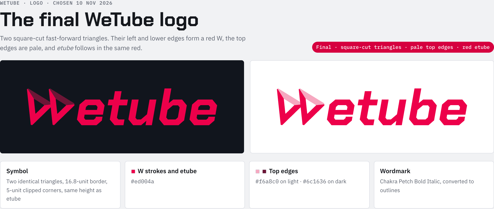

### In use

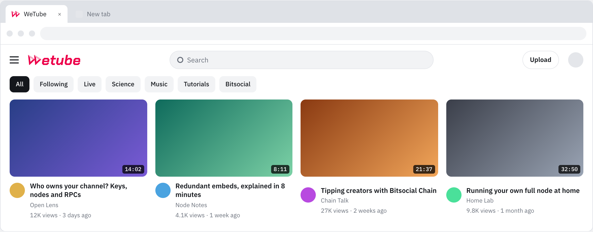

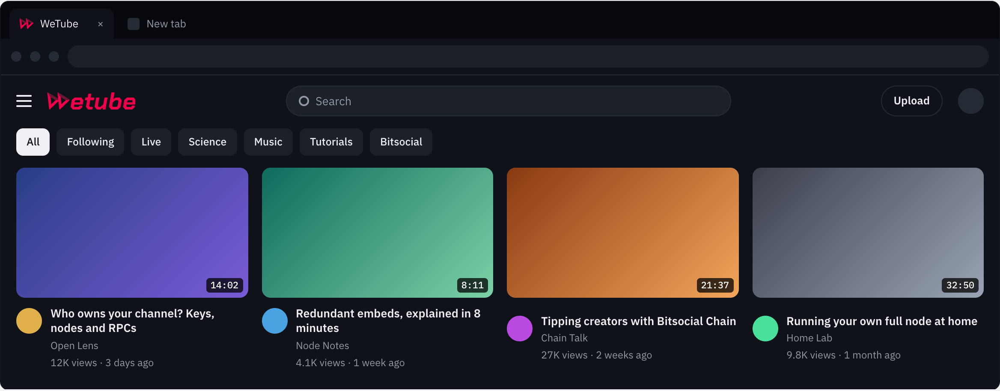

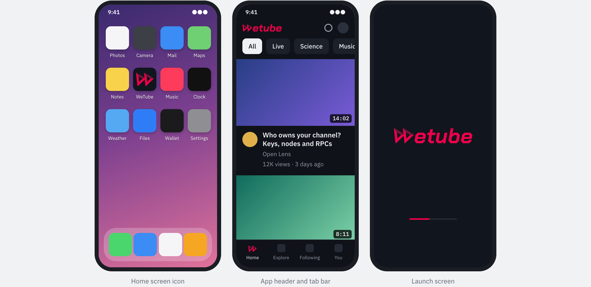

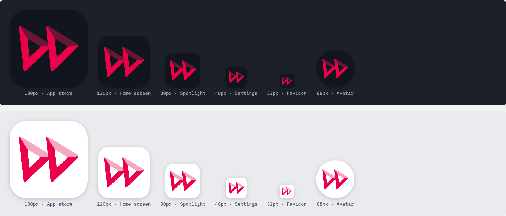

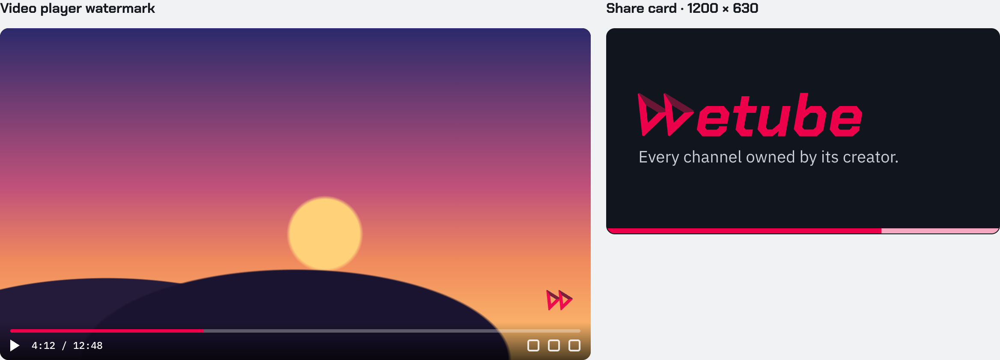

### Backgrounds

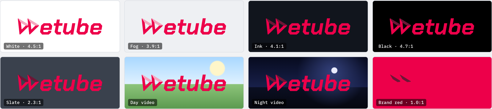

Slate (2.3:1) and brand red (1.0:1) are below 3:1; use white, fog, ink or black behind the logo, or a dark or bright video frame.

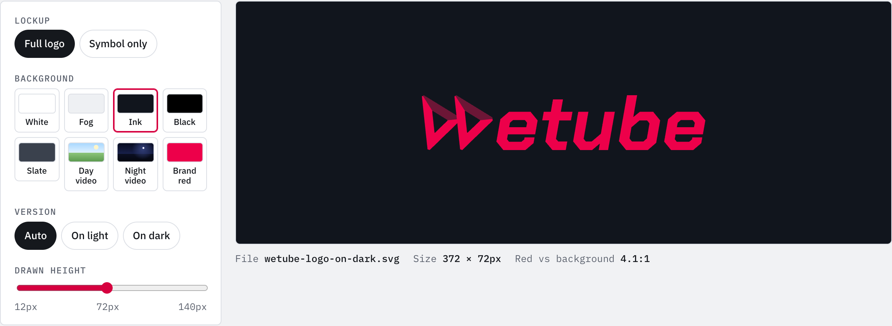

### Sizes, anatomy, color and type

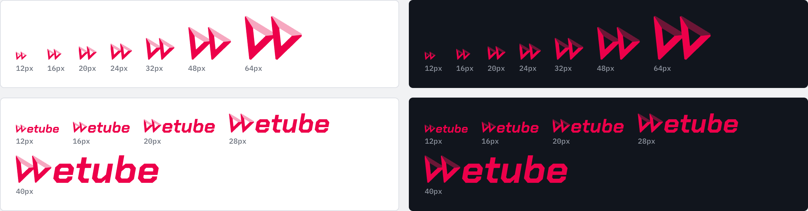

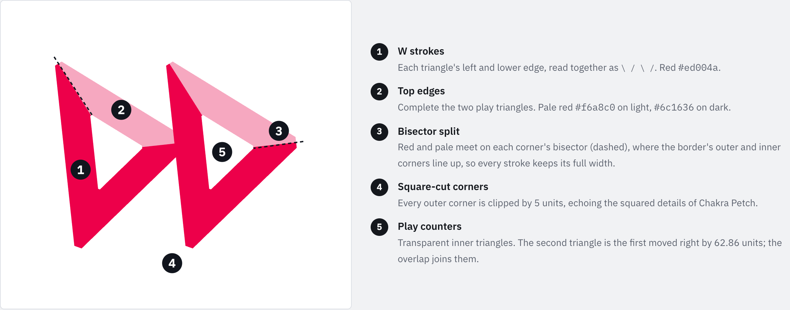

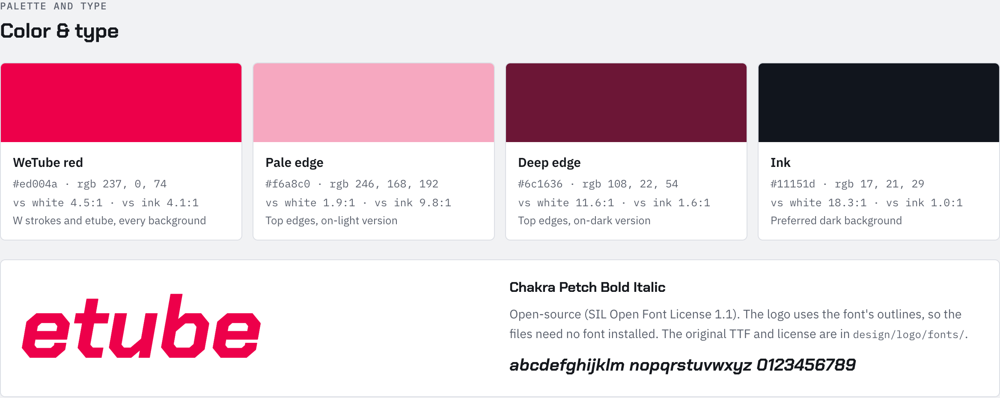
