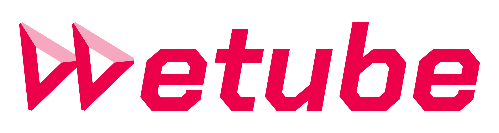

# WeTube logo

Two right-pointing triangles, a fast-forward symbol and the counterpart to a single play button, followed by lowercase **etube**. Each triangle's left and lower edge is red; together they read as the W (`\ / \ /`). The top edges are pale, so the W reads first while the two play triangles stay whole.

| Part | On light | On dark |
| --- | --- | --- |
| W strokes and etube | `#ed004a` (4.5:1 on white) | `#ed004a` (4.1:1 on `#11151d`) |
| Top edges | `#f6a8c0` | `#6c1636` |

Avoid backgrounds where the red drops below 3:1, such as mid grays or the brand red itself.

## Files

| File | Use |
| --- | --- |
| [wetube-logo-on-light.svg](wetube-logo-on-light.svg) · [PNG](wetube-logo-on-light.png) | Full logo, light backgrounds |
| [wetube-logo-on-dark.svg](wetube-logo-on-dark.svg) · [PNG](wetube-logo-on-dark.png) | Full logo, dark backgrounds |
| [wetube-mark-on-light.svg](wetube-mark-on-light.svg) · [PNG](wetube-mark-on-light.png) | Symbol only, light backgrounds |
| [wetube-mark-on-dark.svg](wetube-mark-on-dark.svg) · [PNG](wetube-mark-on-dark.png) | Symbol only, dark backgrounds |

SVGs are self-contained vectors with no font dependency. PNGs are transparent: logos 2400 px wide, symbols 1024 px tall. Every file has an even 24-unit side and 28-unit top and bottom margin around the artwork, so the symbol centers on its own bounds (for example in an app icon).

## Construction

- Both triangles share one outline, repeated 62.86 units to the right, with a 16.8-unit border and 5-unit clipped corners.
- Red and pale meet on each corner's bisector, where the border's outer and inner corners line up, so every stroke keeps its full width.
- The symbol is scaled so its clipped corners span exactly the height of etube: its top meets the top of the `b` and its bottom corners sit on the baseline.
- etube is [Chakra Petch](https://github.com/google/fonts/tree/main/ofl/chakrapetch) Bold Italic, converted to outlines. The font and its SIL Open Font License 1.1 are in [fonts/](fonts/).

[build.py](build.py) regenerates every file: `uv run build.py` (PNGs need `rsvg-convert`).
